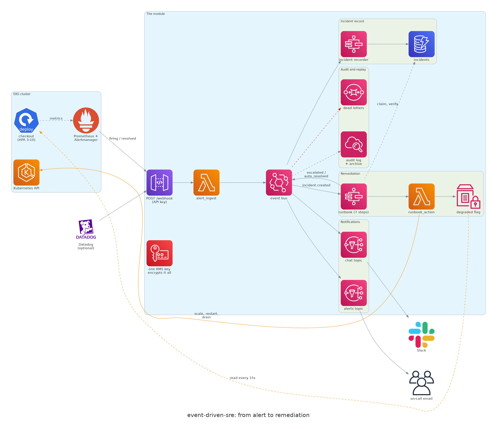
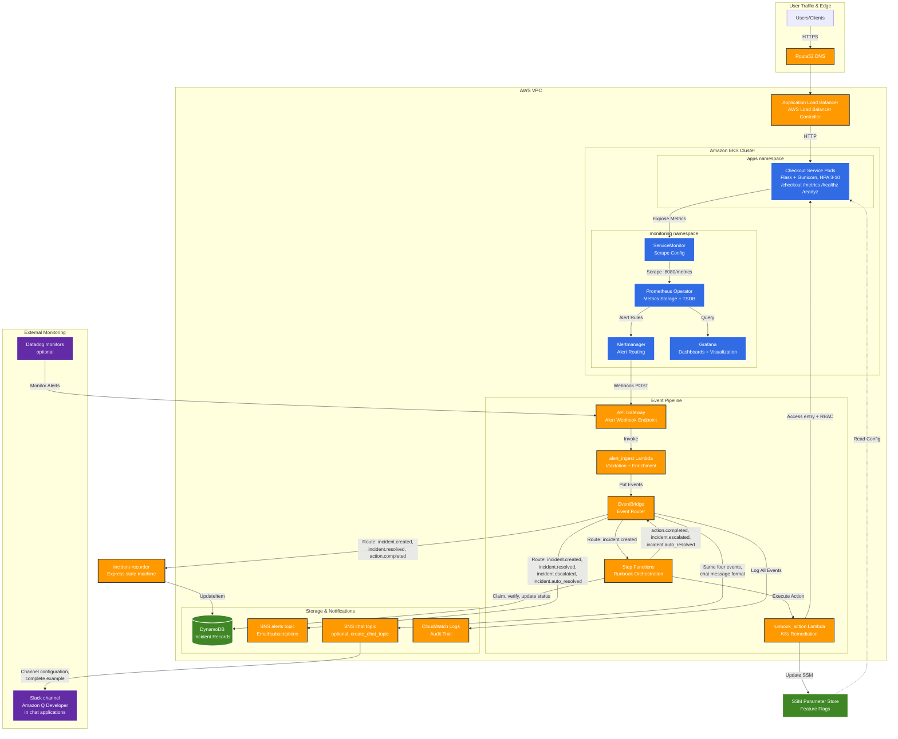
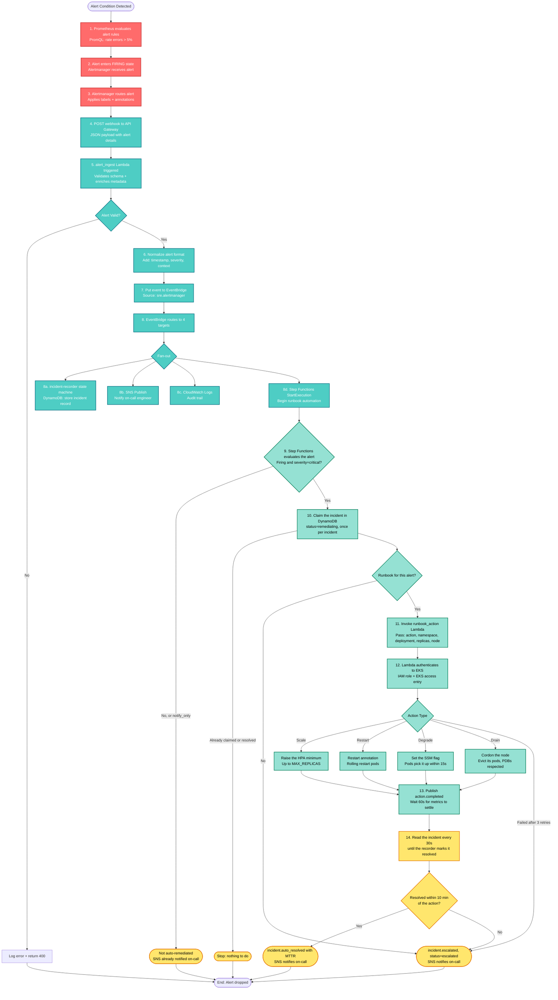
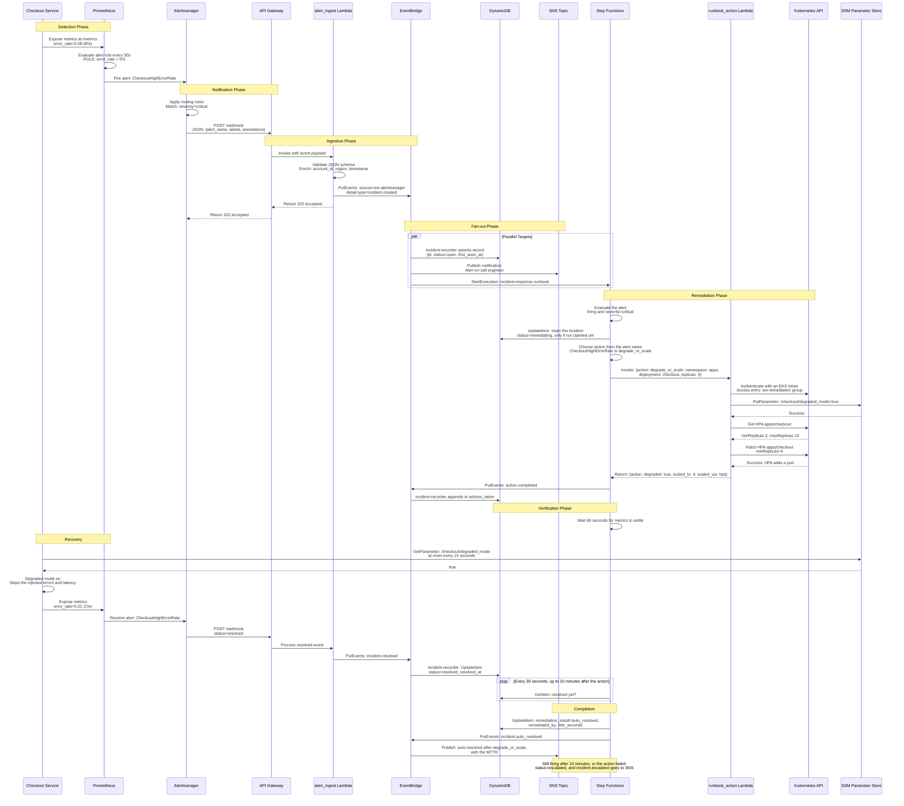
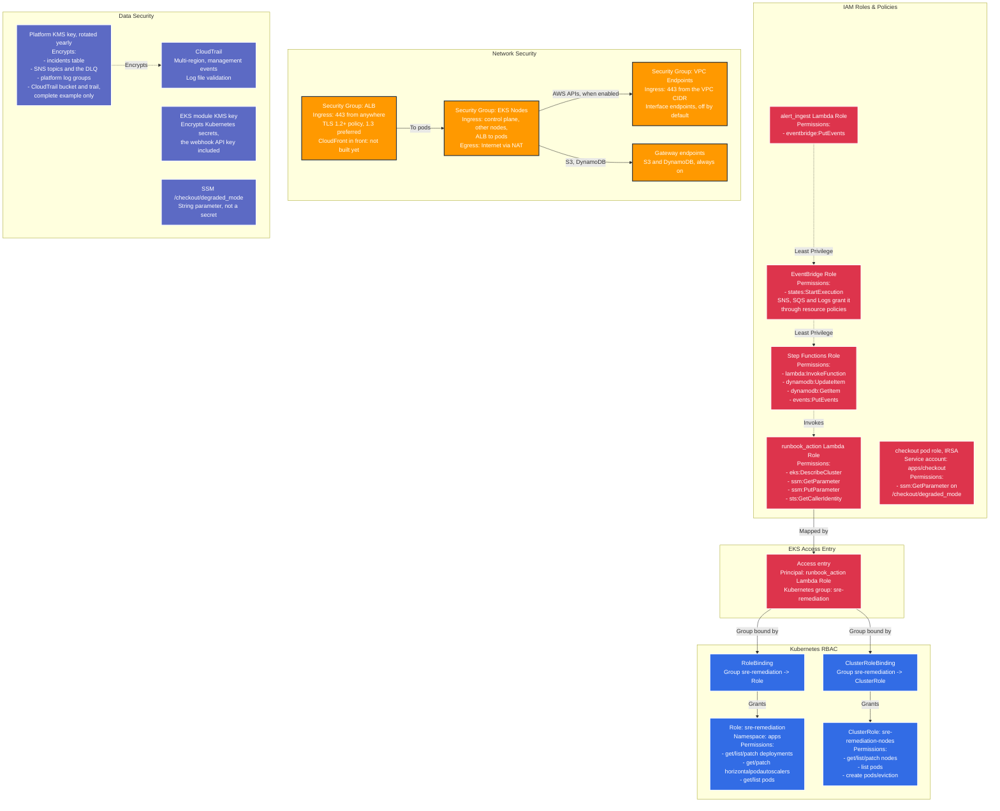

# Architecture

## Overview

How alerts flow through the system, from detection to remediation.

The alert pipeline (webhook, Lambdas, EventBridge, Step Functions, DynamoDB, SNS, KMS) is the Terraform module at the repo root. The VPC, EKS cluster, IRSA roles, ECR, CloudTrail and VPC endpoints come from `examples/complete`, which calls the module.

Names and values like the `apps` namespace, the `checkout` deployment, the `/checkout/degraded_mode` parameter, the `nodegroup=apps` drain label and the alert routes are the ones `examples/complete` passes to the module. The module itself has no routes (nothing is remediated until `runbook_routes` is set), no default deployment, and degraded mode and `drain_node` stay off until `degraded_mode_deployment` and `drainable_node_label` are set.

## Table of Contents

1. [High-Level Architecture](#high-level-architecture)
2. [Alert Lifecycle Flow](#alert-lifecycle-flow)
3. [Incident Response Sequence](#incident-response-sequence)
4. [Security Architecture](#security-architecture)
5. [Component Details](#component-details)

---

## High-Level Architecture



Generated from [diagram.py](diagram.py) with [Diagrams](https://diagrams.mingrammer.com/); the instructions to rebuild it are at the top of that file. The Mermaid diagram below has more detail on the edge and the cluster.



---

## Alert Lifecycle Flow

This diagram shows the numbered sequence of events from alert detection through automated remediation.



---

## Incident Response Sequence

This sequence diagram shows the interactions between components during an incident.



---

## Security Architecture



---

## Component Details

### 1. Detection Layer

**Prometheus Operator**
- Scrapes metrics from `/metrics` endpoint every 15 seconds
- Evaluates PromQL alert rules every 30 seconds
- Doesn't scrape the scheduler, controller manager or etcd. EKS runs them, Prometheus can't reach them, and the chart's rules would report them down for good (`KubeSchedulerDown`, `KubeControllerManagerDown`), which the runbook escalates every time.
- Alert rules defined in PrometheusRule CRD
- TSDB retention: 7 days, one replica, no remote write (`helm/observability/kube-prometheus-stack-values.yaml` in `examples/complete`)

**Alertmanager**
- Groups related alerts (reduces noise)
- Routes alerts based on severity labels
- Sends the chart's always-firing `Watchdog` and `InfoInhibitor` alerts to a `null` receiver, so they don't become incidents
- Deduplicates alerts (5-minute window)
- Webhook integration with API Gateway
- Retry logic: 3 attempts with exponential backoff

**Datadog** (optional)
- Datadog monitors can send to the same webhook; the payload format is in [docs/API.md](../API.md#datadog-webhook-format)
- `examples/complete/helm/datadog/values.yaml` has values for the Datadog agent (logs and APM collection on), but no script installs it, the checkout app isn't instrumented for APM, and the repo defines no Datadog monitors, SLOs or Synthetics tests

### 2. Ingestion Layer

**API Gateway**
- REST API endpoint: `POST /webhook`
- Request validation: JSON schema enforcement
- Throttling: 1000 requests/second
- Authentication: API key in `X-API-Key`, required by default. `webhook_private` makes it a private API that only answers through an execute-api VPC endpoint, which also shuts out Datadog.
- TLS: HTTPS only, with API Gateway's default TLS policy. Pinning a TLS 1.2 minimum on the default endpoint needs AWS provider 6, and the EKS module (~> 20) holds the provider below 6.
- Integration: Lambda proxy integration

**alert_ingest Lambda**
- Runtime: Python 3.13
- Memory: 256 MB
- Timeout: 30 seconds
- Concurrency: unreserved by default (`alert_ingest_reserved_concurrency = -1`). AWS keeps at least 50 to 100 executions unreserved per account and new accounts often have a limit of 50, so any reservation fails there. Set a number to cap it.
- Functions:
  - Validate alert payload schema
  - Enrich with AWS metadata (account, region, timestamp)
  - Normalize alert format across sources (Alertmanager, Datadog)
  - Transform to EventBridge event format
  - Error handling: invalid alerts logged to CloudWatch

### 3. Event Routing Layer

**EventBridge**
- Custom event bus: `event-driven-sre-bus` (`<name>-bus`)
- Event sources: `sre.alertmanager`, `sre.datadog`, and `sre.runbook` for the runbook's own events
- Event patterns for routing:
  - `incident.created` -> DynamoDB, SNS, Step Functions
  - `incident.resolved` -> DynamoDB, SNS
  - `action.completed` -> DynamoDB
  - `incident.escalated` -> SNS
  - `incident.auto_resolved` -> SNS
  - with `create_chat_topic`, the four SNS rules also send to the chat topic
  - every `sre.*` event -> CloudWatch Logs, `/aws/events/<name>`, kept 30 days
- DynamoDB writes go through the `incident-recorder` Express state machine, since DynamoDB isn't an EventBridge target
- Archive: 7-day event replay capability
- Dead-letter queue: every target retries for up to an hour (20 attempts), then sends the event to an SQS queue that keeps it 14 days

### 4. Orchestration Layer

**Step Functions**
- State machine: `event-driven-sre-runbook` (`<name>-runbook`), a Standard workflow written in JSONata. The `incident.created` rule starts it with the incident as input.
- Steps:
  1. **Evaluate Alert**: only firing alerts with a severity in `auto_remediate_severities` (default `critical`) go on. Warnings, info alerts and alerts annotated `runbook_action: notify_only` stop here; SNS has already notified on-call.
  2. **Log Incident**: a conditional `UpdateItem` sets `status=remediating`, `remediation_started_at` and `runbook_execution`. It only succeeds once per incident, and not after the alert has resolved, so re-sent alerts and duplicate deliveries stop here.
  3. **Choose Action**: map the alert name to an action with `runbook_routes`. In `examples/complete`, `CheckoutHighErrorRate`, `CheckoutHighLatencyP95` and `CheckoutSLOBurnFast` get `degrade_or_scale`, `CheckoutDown` gets `restart`, `NodeUnderPressure` gets `drain_node`. A `runbook_action` annotation overrides the table. The namespace comes from the alert's `namespace` label (or Datadog's `kube_namespace` tag), else the first of `remediation_namespaces`; the deployment from its `deployment` label, `kube_deployment` tag or `service` label, else `default_deployment`; replicas from a `desired_replicas` annotation, else `default_scale_replicas` (4); the node from its `node` label or Datadog's `host` tag (the EC2 private DNS name, which is the node name). No runbook for the alert means escalate.
  4. **Execute Action**: invoke runbook_action. `InvalidRequest` (bad input) isn't retried; anything else gets 3 retries with exponential backoff and jitter. Either way the result goes out as an `action.completed` event, and a failure escalates.
  5. **Wait for Stabilization**: 60 seconds (`stabilization_seconds`)
  6. **Verify Resolution**: read the incident from DynamoDB every 30 seconds (`verify_poll_seconds`) until the incident recorder has marked it resolved, for up to 10 minutes after the action (`verify_timeout_seconds`). The original plan was 5 minutes, but the alert's 5 minute rate window plus Alertmanager's 2 minute `group_interval` mean a fixed service usually reads as resolved 3 to 7 minutes after the action.
  7. **Update Status**: if resolved, set `remediation_result=auto_resolved`, `remediated_by` and `mttr_seconds`, and publish `incident.auto_resolved`. MTTR runs from when the platform first saw the alert to when it saw the resolution. Otherwise set `status=escalated` and `escalation_reason`, publish `incident.escalated`, and end the execution as failed. An incident that resolved in the meantime isn't escalated.
- Escalation reasons: no runbook for the alert, the action failed after its retries, the alert still firing at the end of the verify window, or DynamoDB failing when the incident is logged or checked
- Error handling: the DynamoDB and EventBridge steps also retry 3 times with backoff
- Logs: `/aws/vendedlogs/states/<name>-runbook`, every state with its input and output, kept 30 days
- Execution history: 90 days

**runbook_action Lambda**
- Runtime: Python 3.13
- Memory: 512 MB
- Timeout: 120 seconds
- VPC: Attached to private subnets (access to EKS API)
- Input: `{incident_id, alertname, severity, action, namespace, deployment, replicas, node}` from the state machine. It runs the action it's given and doesn't choose one itself.
- Actions:
  - **degrade**: set the SSM parameter `/checkout/degraded_mode` to `true`. The checkout pods read it live, so there's no restart. Only `degraded_mode_deployment` has a degraded mode (`DEGRADED_DEPLOYMENT`); degrading any other deployment is an `InvalidRequest`, and so is any degrade when `degraded_mode_deployment` isn't set.
  - **scale**: if the deployment has an HPA, raise its `minReplicas` to the target (and `maxReplicas` too if the target is above it); patching the deployment's replicas directly would be undone by the HPA within seconds. Without an HPA it patches the replicas.
  - **restart**: rolling restart through the restart annotation
  - **degrade_or_scale**: degrade, then scale
  - **drain_node**: cordon the node, then evict its pods through the Eviction API the way `kubectl drain` does, skipping DaemonSet and mirror pods and pods that are finished or already terminating. A pod with no owner isn't evicted, since nothing would recreate it; it's listed under `unmanaged`. Evictions a PodDisruptionBudget blocks are retried every 5 seconds for up to a minute, then left; the result lists them, and the verify step decides whether the alert cleared. The node stays cordoned; replacing or uncordoning it is left to a person.
- Validation: raises `InvalidRequest` for an unknown action, a namespace that isn't in `ALLOWED_NAMESPACES` (`remediation_namespaces`), a deployment name that isn't a valid Kubernetes name, or replicas outside 1 to `MAX_REPLICAS` (`remediation_max_replicas`, default 10, the HPA's maximum). For `drain_node`: a missing or invalid node name, a node that doesn't exist, a node without the `drainable_node_label` label (`DRAINABLE_NODE_LABEL`, `nodegroup=apps` in the example; system nodes need a person), any drain when `drainable_node_label` isn't set, or fewer than 1 other Ready, schedulable apps node to take its pods (`drain_min_schedulable_nodes`).
- Nothing is put back after the incident resolves. Degraded mode stays on and the HPA minimum stays raised until someone reverts them (a `helm upgrade` of the checkout chart also resets the minimum to 3):
  ```bash
  aws ssm put-parameter --name /checkout/degraded_mode --value false --overwrite
  kubectl patch hpa checkout -n apps --type merge -p '{"spec":{"minReplicas":3}}'
  kubectl uncordon NODE_NAME   # after a drain, once the node is healthy
  ```
- Kubernetes access: an EKS access entry maps its IAM role to the `sre-remediation` group (IRSA only applies to pods)
- RBAC: the module's `rbac_manifest` output (rendered from `templates/rbac.yaml.tftpl`), applied with `terraform output -raw rbac_manifest | kubectl apply -f -`. It has a Role in each of `remediation_namespaces` for deployments and HPAs, and, only when `drainable_node_label` is set, a ClusterRole for nodes, listing pods and creating evictions. Nodes are cluster-scoped and a node runs pods from every namespace, so draining can't be done with a namespaced Role. There's no permission to delete pods.

### 5. Storage & Notification Layer

**DynamoDB**
- Table: `event-driven-sre-incidents` (`<name>-incidents`)
- Primary key: `incident_id`, no sort key. It's a version 5 UUID derived from the Alertmanager fingerprint and `startsAt`, or the Datadog `alert_cycle_key`, so it already identifies one occurrence of an alert; a `timestamp` sort key would mean every writer needs the start time, which a Datadog recovery event doesn't carry.
- Global secondary index `by-status`: `status` and `first_seen_at`, to list open or escalated incidents newest first
- Attributes:
  - `alertname`, `service`, `severity` (critical, warning, info), `source`
  - `status`: open, remediating, resolved, escalated
  - `first_seen_at`, `last_seen_at`, `resolved_at`, `remediation_started_at`, `escalated_at`: ISO 8601 strings
  - `actions_taken`: List of `{action, result, at, execution}`, plus `last_action`, `last_action_result`, `last_action_at`
  - `remediation_result` (auto_resolved or escalated), `remediated_by`, `mttr_seconds`, `escalation_reason`, `runbook_execution`
  - `notification_count`, `correlation_id`
  - `payload`: the full normalized alert as JSON, labels included
  - `expires_at`: Number (Unix time), the TTL attribute
- Encryption: the platform's customer managed KMS key (`alias/<name>`)
- Point-in-time recovery: Enabled
- TTL: 90 days after the incident's last activity (`incident_retention_days`)
- Deletion protection: Enabled (`incidents_deletion_protection`). `examples/complete/scripts/destroy.sh` turns it off before `terraform destroy`.

**SNS Topics**
- Alerts topic: `<name>-alerts` (output `sns_topic_arn`). EventBridge publishes a one-line text message per event, like `[critical] checkout - CheckoutHighErrorRate is firing. ... (incident <id>)`.
- Chat topic: `<name>-chat` (output `chat_topic_arn`), only with `create_chat_topic = true`. The same four rules publish to it in the custom notification format of Amazon Q Developer in chat applications (AWS Chatbot), which only renders its own format. Titles look like `critical: CheckoutHighErrorRate is firing on checkout`, `Escalated: X on Y needs a person`, `Resolved: X on Y` and `Auto-resolved: X on Y`, with the incident ID in the text.
- Both are encrypted with the platform key and refuse publishes without TLS.
- Subscriptions:
  - Email: one per address in `notification_emails`, on the alerts topic. SNS sends each address a confirmation email, and nothing arrives until the link in it is clicked.
  - Slack: `examples/complete/chatbot.tf` subscribes a Slack channel configuration to the chat topic (see [examples/complete](../../examples/complete/README.md#slack-and-email)). It's in the example, not the module, because the Chatbot API isn't in every region (not in `us-east-1`).
  - PagerDuty: not built. A PagerDuty SNS integration would subscribe to the alerts topic.
- No message filtering: every subscriber gets all four event types

**CloudWatch Logs**
- Log groups:
  - `/aws/lambda/<name>-alert-ingest`
  - `/aws/lambda/<name>-runbook-action`
  - `/aws/vendedlogs/states/<name>-runbook` (every state's input and output)
  - `/aws/vendedlogs/states/<name>-incident-recorder` (failed writes only; Express workflows keep no execution history)
  - `/aws/events/<name>` (every event on the bus)
- Retention: 30 days for all five, encrypted with the platform KMS key. Terraform creates the Lambda log groups too, so Lambda doesn't make unencrypted ones that never expire.
- No dashboards, saved Insights queries or metric filters are built yet

### 6. Application Layer

**Checkout Service**
- Framework: Flask on Gunicorn, 1 worker with 8 threads. prometheus_client keeps its metrics per process, so with several workers each scrape would only see one worker's counters; it scales with replicas instead.
- Image: `python:3.13-slim`, running as a non-root user (UID 10001)
- Replicas: 3 to 10, set by a HorizontalPodAutoscaler at 70% CPU. metrics-server runs as an EKS add-on for it; the complete example opens its port, 10251, from the control plane to the nodes, or the HPA never gets CPU metrics. The chart's `replicaCount` (3) only applies with autoscaling turned off.
- PodDisruptionBudget: at least 2 pods available, so a drain evicts them a few at a time
- Spread: pods are spread across nodes (`topologySpreadConstraints` on the hostname, best effort)
- Resources:
  - Requests: 100m CPU, 128Mi memory
  - Limits: 500m CPU, 512Mi memory
- Health checks:
  - Liveness: `/healthz` (timeout 5s)
  - Readiness: `/readyz` (failure threshold 3)
- Degraded mode: starts from the `DEGRADED_MODE` env var, then follows the SSM parameter `/checkout/degraded_mode` (`DEGRADED_PARAM`). `/checkout` requests and Prometheus scrapes of `/metrics` check it at most every 15 seconds (`DEGRADED_REFRESH_SECONDS`). The SSM call has a 1 second timeout and no retries, so a slow SSM doesn't hold up a checkout. If it can't be read, the pod keeps the last value and logs one warning until a read works again. Degraded mode skips the injected latency and errors.
- AWS access: the `checkout` service account has an IRSA role that can only `ssm:GetParameter` that one parameter
- Metrics: Prometheus client library
  - Counters: `http_requests_total` (by route and code), `checkout_success_total`, `checkout_failure_total`, `dependency_errors_total`
  - Histograms: `http_request_duration_seconds`
  - Gauges: `in_flight_requests`, `checkout_degraded_mode_enabled` (0 or 1)
- Chaos engineering:
  - `LATENCY_MS`: Inject artificial latency
  - `ERROR_RATE`: Random error injection (0.0-1.0)
  - `CHAOS`: Count random fake dependency errors in `dependency_errors_total`; responses aren't affected
  - `DEGRADED_MODE`: Degraded mode's starting value

---

## Key Design Decisions

### 1. Serverless Event Pipeline
**Decision**: Use Lambda + EventBridge instead of EKS-hosted services
**Rationale**:
- Lower operational overhead (no pods to manage)
- Auto-scaling without capacity planning
- Pay-per-use pricing for bursty alert traffic
- Built-in retry and error handling

**Trade-offs**:
- Cold start latency on the first alert after a quiet spell
- Vendor lock-in to AWS
- Debugging across distributed services

### 2. IAM-Based Kubernetes Access
**Decision**: Use IAM identities instead of long-lived credentials: IRSA for pods, and an EKS access entry for the runbook_action Lambda, since IRSA only applies to pods
**Rationale**:
- No secrets to rotate or leak
- Short-lived credentials
- Audit trail in CloudTrail
- Fine-grained permissions per namespace

**Trade-offs**:
- Complex initial setup (OIDC provider for IRSA, access entries for the Lambda)
- Access entries need the cluster's authentication mode set to `API` or `API_AND_CONFIG_MAP`

### 3. EventBridge as Central Bus
**Decision**: Route all events through EventBridge instead of direct integrations
**Rationale**:
- Decouples producers and consumers
- Easy to add new targets without code changes
- Built-in event filtering and transformation
- Event replay for debugging

**Trade-offs**:
- Additional latency (10-50ms)
- Event payload size limit (256 KB)

### 4. Step Functions for Orchestration
**Decision**: Use Step Functions instead of custom Lambda orchestration
**Rationale**:
- Visual workflow editor
- Built-in error handling and retries
- State persistence (no external database needed)
- Execution history for compliance

**Trade-offs**:
- Cost at high scale ($25 per 1M state transitions)
- Limited to 25,000 execution history
- ASL (Amazon States Language) learning curve

---

## Observability & Monitoring

### Metrics Collected
- **Application metrics**: Request rate, error rate, latency (p50, p95, p99)
- **Pipeline metrics**: Alert ingestion rate, remediation success rate, MTTR
- **Infrastructure metrics**: Pod CPU/memory, node capacity, Lambda duration

### Dashboards and alerts on the pipeline

Not built yet. kube-prometheus-stack brings its own Grafana dashboards for the cluster, but there are no dashboards for the pipeline, and no CloudWatch alarms on it. The ones worth adding first:

- alert_ingest Lambda errors
- messages in the events dead-letter queue (`events_dlq_url`)
- failed runbook executions and runbook_action Lambda errors

---

## Disaster Recovery

### Failure Scenarios

**Scenario 1: alert_ingest Lambda fails**
- Impact: Alerts not ingested, no remediation
- Detection: the Lambda's `Errors` metric (no alarm is built yet) and Alertmanager's failed-notification logs
- Mitigation: Alertmanager retries webhook (3 attempts), DLQ captures failed events
- Recovery: Replay events from EventBridge archive

**Scenario 2: EKS API unreachable**
- Impact: Remediation actions fail
- Detection: runbook_action Lambda errors or times out
- Mitigation: Step Functions retry (3 attempts, exponential backoff with jitter)
- Escalation: after the retries, the runbook marks the incident `escalated` and publishes `incident.escalated`, which goes to SNS

**Scenario 3: EventBridge target failure**
- Impact: Incidents not logged to DynamoDB
- Detection: messages in the dead-letter queue and failures in the incident recorder's log group (no alarm is built yet)
- Mitigation: EventBridge DLQ captures failed events
- Recovery: Reprocess events from DLQ

**Scenario 4: DynamoDB table deleted**
- Impact: No incident history
- Detection: Terraform state drift
- Mitigation: Point-in-time recovery is on, so the table can be restored to any second in the last 35 days
- Prevention: Deletion protection is on; deleting the table, `terraform destroy` included, fails until it's turned off

---

## Scalability Considerations

### Current Limits
- Alert ingestion: 1000 alerts/second (API Gateway throttle)
- Concurrent remediations: the account's unreserved Lambda concurrency by default; `runbook_action_reserved_concurrency` caps it (10 is a good cap) if the account limit has room
- Event throughput: 10,000 events/second (EventBridge soft limit)
- Incident storage: no practical limit; the table is on-demand (`PAY_PER_REQUEST`)

### Scaling Strategies
1. **Horizontal scaling**: Increase Lambda concurrency
2. **Batching**: Group alerts in 5-second windows to reduce invocations
3. **Caching**: Cache EKS cluster info in Lambda environment variables
4. **Sharding**: Separate event buses per region or environment

---

## Cost Optimization

The monthly cost of `examples/complete`, line by line, is in [its README](../../examples/complete/README.md#cost). The module on its own is about $14 a month at 1000 alerts a day, plus $1 for its KMS key; nearly all of it is the runbook's Step Functions transitions.

### Optimization Techniques
- Tear it down when you're not using it; the fixed cluster costs are about 95% of the bill
- Interface endpoints only pay for themselves once more than about 2.5 TB a month would otherwise go through the NAT gateways
- Most of the pipeline cost is the runbook polling DynamoDB; a longer `verify_poll_seconds` or a shorter `verify_timeout_seconds` cuts state transitions
- Set `enable_cloudtrail = false` if an organization trail already covers the account; a second copy of management events is billed
- Reduce Lambda memory if not needed (alert_ingest can use 128 MB)

---

## Security Best Practices Implemented

- Least-privilege IAM policies (no wildcards for application resources)
- Encryption at rest: one customer managed KMS key, rotated yearly, for the incidents table, the SNS topics, the dead-letter queue, the platform's log groups and CloudTrail. Kubernetes secrets use the EKS module's own key, and ECR images AES-256.
- Encryption in transit: a TLS 1.2+ policy on the ALB (TLS 1.3 preferred), and the SNS topics, the dead-letter queue and the CloudTrail bucket refuse requests without TLS. The webhook is HTTPS only, but its TLS policy can't be pinned until the move to AWS provider 6.
- IRSA and EKS access entries instead of long-lived credentials
- Kubernetes RBAC: workload changes limited to the `apps` namespace, and a ClusterRole only for cordoning nodes and evicting pods
- VPC security groups (allow-list only)
- CloudTrail: a multi-region trail of management events with log file validation (`enable_cloudtrail`, on by default)
- Secrets: the only secrets are the webhook API keys, kept in a Kubernetes Secret that EKS encrypts. The SSM degraded flag is a plain String and isn't sensitive.
- Container images: ECR scan on push and immutable tags, plus Trivy in CI
- Network segmentation: private subnets for EKS and the remediation Lambda, S3 and DynamoDB gateway endpoints, optional interface endpoints (`enable_vpc_endpoints`) and an optional private webhook (`webhook_private`)
- VPC flow logs, encrypted and kept 30 days
- Nodes require IMDSv2 with a hop limit of 1, so pods can't borrow the node's IAM role
- Not built yet: CloudFront and WAF in front of the ALB. The EKS public endpoint is open to the internet unless `eks_public_access_cidrs` is set.

---

## Future Enhancements

Ideas, none of them started:

### Smaller
- Add more runbook actions (canary deployment, traffic shift)
- Implement alert correlation (group related alerts)
- Add Slack bot for interactive remediation approval

### Larger
- Machine learning for anomaly detection
- Automated rollback if remediation causes further degradation
- Cost anomaly detection and auto-scaling

### Much larger
- Multi-cloud support (GCP, Azure)
- Chaos engineering platform integration (Gremlin, Chaos Mesh)
- Self-healing infrastructure (auto-replace unhealthy nodes)
- Predictive alerting (forecast incidents before they occur)

---

## References

- [AWS Lambda Best Practices](https://docs.aws.amazon.com/lambda/latest/dg/best-practices.html)
- [EKS IRSA Documentation](https://docs.aws.amazon.com/eks/latest/userguide/iam-roles-for-service-accounts.html)
- [EventBridge Event Patterns](https://docs.aws.amazon.com/eventbridge/latest/userguide/eb-event-patterns.html)
- [Prometheus Alert Rules](https://prometheus.io/docs/prometheus/latest/configuration/alerting_rules/)
- [Step Functions Error Handling](https://docs.aws.amazon.com/step-functions/latest/dg/concepts-error-handling.html)

