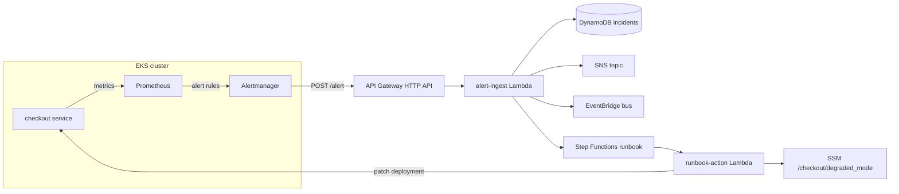

# Architecture

Resource names below assume the default `name` variable, `event-driven-sre`.

## Alert path

1. The `checkout` service exposes request counts and latency on `/metrics`. Prometheus scrapes it through a ServiceMonitor and evaluates the rules in `helm/observability/prom-rules/`.
2. When a rule fires or resolves, Alertmanager posts the standard webhook payload to `POST /alert` on the API Gateway HTTP API (stage `prod`). Alertmanager is configured with `send_resolved: true`.
3. `event-driven-sre-alert-ingest` (Python 3.12, 15 s timeout) loops over `alerts` in the payload and, for each one:
   - builds a normalized record: a new `incident_id`, a timestamp, `status`, `severity` (default `ticket`), `service` (default `unknown`), `alertname`, the labels and annotations, and the runbook Lambda's ARN
   - writes it to the `event-driven-sre-incidents` DynamoDB table
   - puts it on the `event-driven-sre-bus` EventBridge bus (source `prometheus.alertmanager`, detail type `SREAlert`)
   - publishes it to the `event-driven-sre-alerts` SNS topic, with the subject `[SEVERITY] service - alertname (status)`
   - starts an execution of the `event-driven-sre-runbook` state machine with the record as input

   See [API.md](../API.md) for the request and response format.
4. The state machine has one task: invoke the runbook Lambda with the record. It retries up to 3 times, starting at 2 seconds and doubling.

## Remediation

`event-driven-sre-runbook-action` (Python 3.12, 30 s timeout) picks an action from the alert name:

| Alert | Action |
| --- | --- |
| `CheckoutHighErrorRate`, `CheckoutHighLatencyP95`, `CheckoutSLOBurnFast` | `degrade_or_scale` |
| `CheckoutDown` | `restart` |
| anything else | `notify_only` |

A `runbook_action` annotation on the alert overrides this. Valid values are `degrade`, `restart`, `scale`, `degrade_or_scale` and `notify_only`.

What each action does to the deployment set by `TARGET_NAMESPACE` and `TARGET_DEPLOYMENT` (`apps/checkout`):

- `degrade`: sets the SSM parameter `/checkout/degraded_mode` to `true`, sets `DEGRADED_MODE=true` on the container with a strategic merge patch, then restarts the deployment. In degraded mode the app skips its injected errors and latency.
- `restart`: patches the `kubectl.kubernetes.io/restartedAt` annotation on the pod template, the same thing `kubectl rollout restart` does.
- `scale`: sets replicas to the alert's `desired_replicas` annotation, or 4.
- `degrade_or_scale`: `degrade`, then `scale`.
- `notify_only`: nothing; it returns without contacting the cluster.

To reach the cluster, the Lambda calls `eks:DescribeCluster` for the endpoint and CA, then builds an EKS bearer token by presigning an STS `GetCallerIdentity` request with its own IAM role. That role has no EKS access entry yet, so the Kubernetes API rejects the calls. See [Known gaps](../../README.md#known-gaps).

## Infrastructure

- **VPC:** two availability zones, public and private subnets, and a NAT gateway in each zone (`terraform-aws-modules/vpc`).
- **EKS:** version 1.29 by default (`terraform-aws-modules/eks` ~> 20). Private and public API endpoints are both on; the public one is there for the first bootstrap. All five control plane log types are enabled.
- **Node groups:** `system` (tainted `dedicated=system:NoSchedule`) and `apps`, both `m6i.large` by default with 2 nodes each, scaling to 6 and 10.
- **Cluster add-ons:** CoreDNS, kube-proxy and the VPC CNI as EKS add-ons. The AWS Load Balancer Controller, ExternalDNS and cert-manager are installed with Helm by `scripts/install-addons.sh`.
- **IRSA roles:** for the Load Balancer Controller, ExternalDNS (limited to the hosted zones in `route53_zone_arns`), cert-manager (Route 53 access only when `cert_manager_route53_enabled` is set) and the EBS CSI driver.
- **Observability:** kube-prometheus-stack, plus the `checkout` chart's ServiceMonitor. `helm/datadog/values.yaml` is there if you want the Datadog agent as well; `alert-ingest` only understands the Alertmanager payload.

## Design choices

**Alert handling runs outside the cluster.** API Gateway, Lambda, DynamoDB and SNS have nothing to patch or scale, cost almost nothing when no alerts arrive, and keep recording and notifying even when the cluster is the thing that's broken. The cost is that one alert's path crosses several services, so debugging means checking several log groups.

**Step Functions sits between ingest and remediation.** It gives the remediation call retries with backoff and an execution history for every run, without adding code to the ingest function. Today the state machine is a single step; it's the place to add checks or approvals later.

**Every alert goes on an EventBridge bus.** Other consumers can subscribe later without changing `alert-ingest`. Nothing subscribes yet.

**Kubernetes access differs by caller.** Add-ons that run as pods use IRSA. The runbook Lambda isn't a pod, so it authenticates as its IAM role and needs an EKS access entry, scoped to patching deployments in `apps`.
